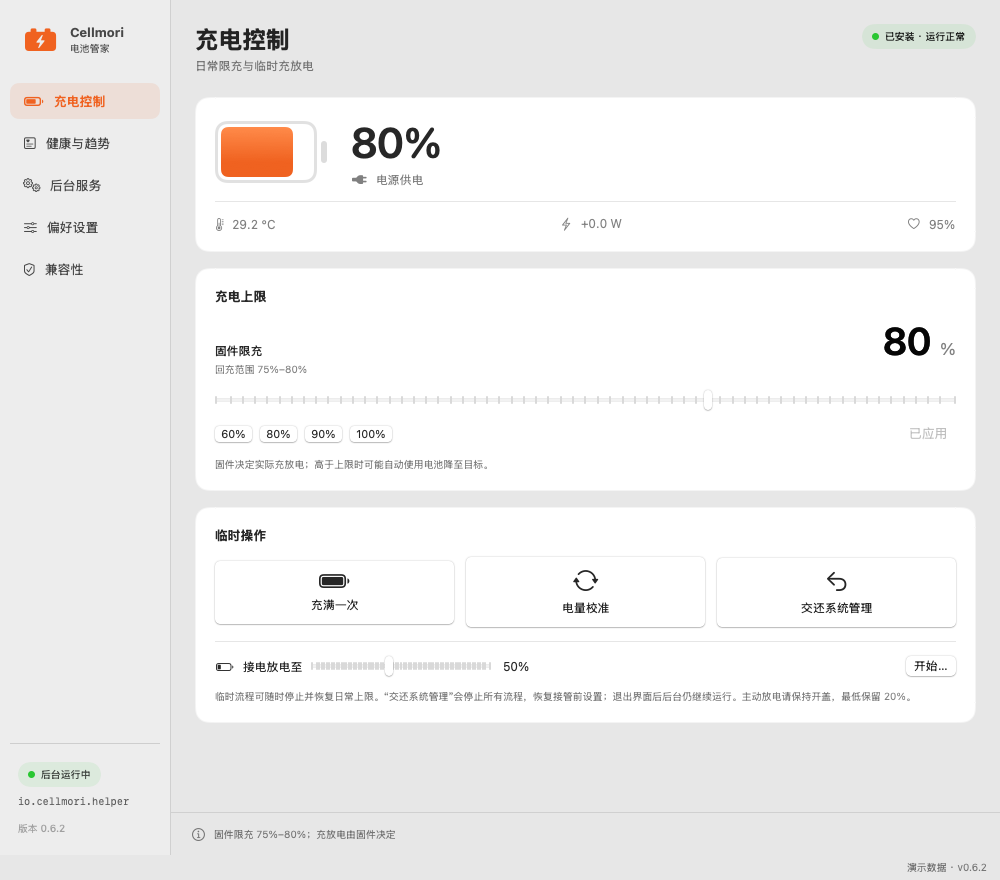
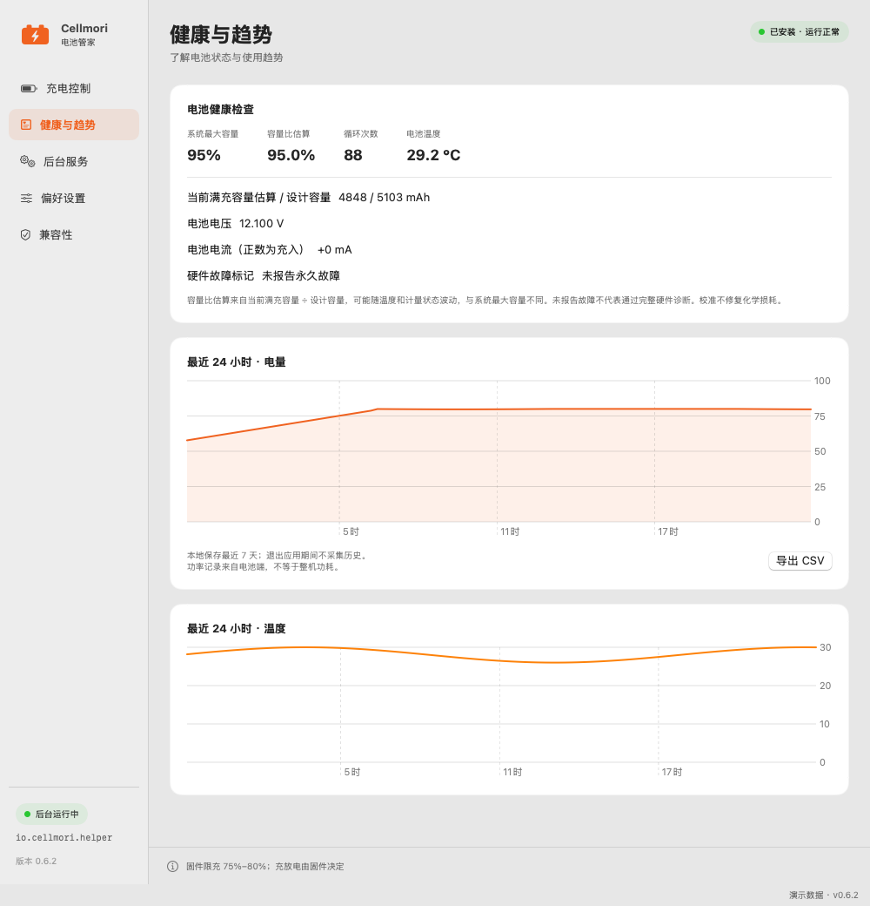
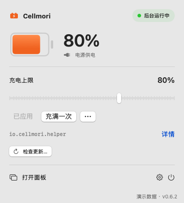
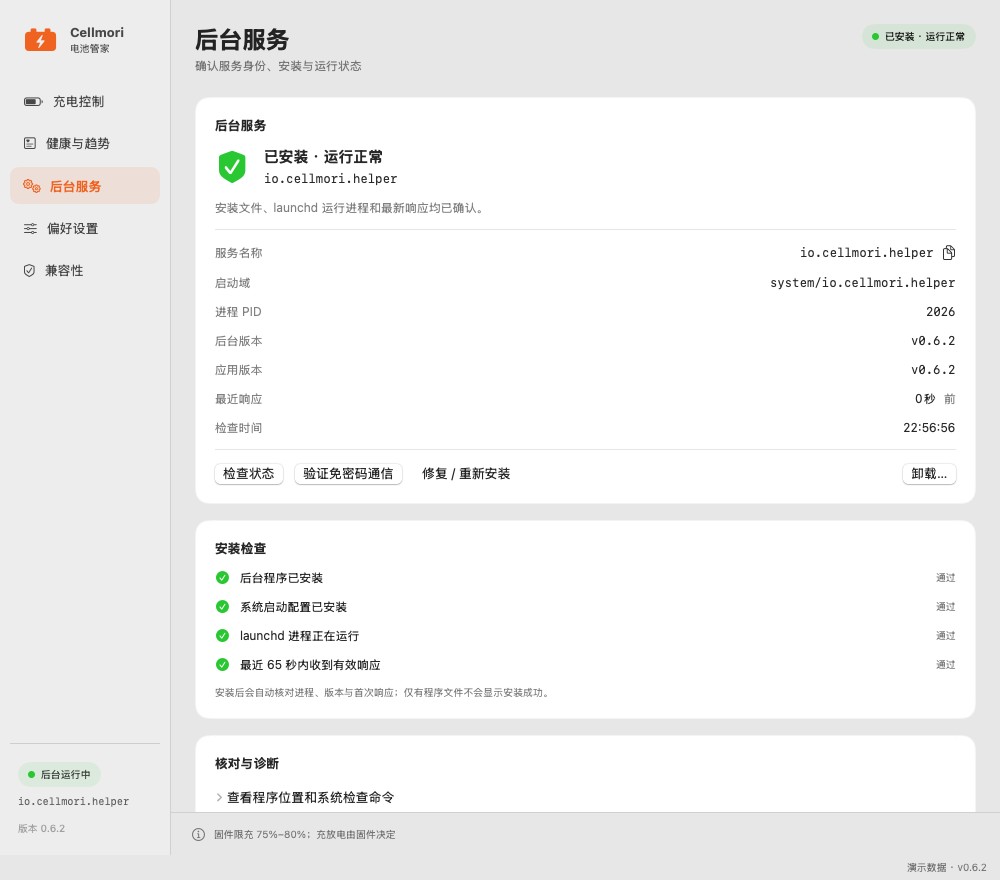
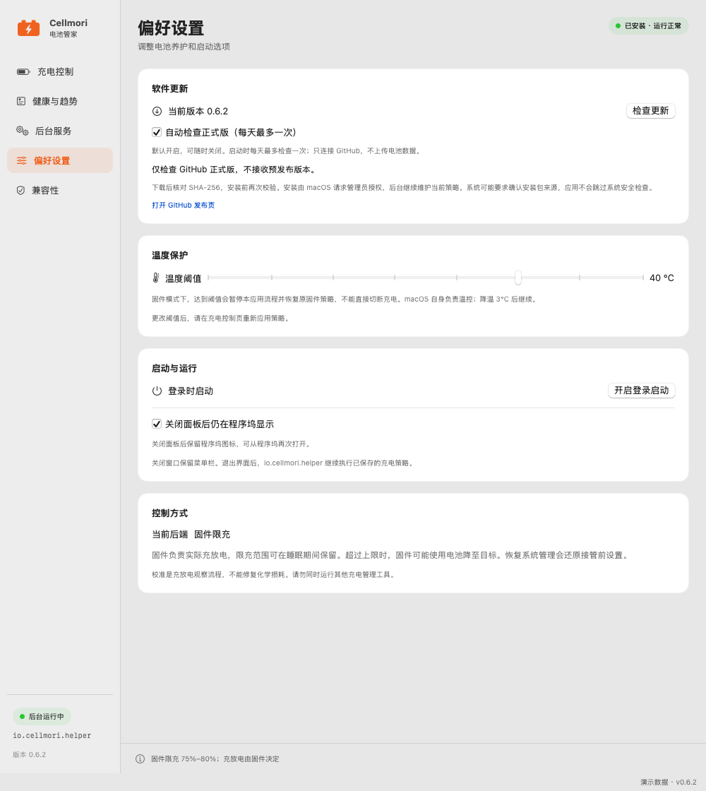

<div align="center">

# Cellmori

**A charge ceiling. A clearer view of your battery.**

Native macOS battery management · charge limits · full-charge override · discharge targets · local trends

[Download PKG](https://github.com/AlanSune/Cellmori/releases/latest) · [中文](README.md) · [Report an issue](https://github.com/AlanSune/Cellmori/issues)



</div>

## Built for everyday battery control

- Set a daily ceiling from 40% to 100%, with a five percentage point recharge band.
- Charge fully once before heading out, then restore the saved daily limit.
- Discharge to a target while plugged in, or stop and restore the daily limit at any time.
- See system battery health, cycle count, temperature and seven days of local history; export CSV.
- Check percentage and power source from a native menu bar panel.
- Make daily changes through authenticated XPC without repeated administrator prompts.
- Check official releases in-app, download and verify the PKG, then open the macOS installer; the verified installation reopens the app as the logged-in user. Daily checks are on by default and can be disabled.

App/helper version: **0.6.2**. Source license: **MIT**. No external package dependencies or built-in telemetry uploads.

## Interface previews

Images are offscreen renders of the actual application views using clearly labelled demo data. They are not macOS 26 hardware screenshots or personal battery records.



<table><tr><td width="36%"></td><td></td></tr></table>

Opening the dashboard, preferences or backend details now dismisses the originating menu panel first, so it no longer stays above the destination window.

## Compatibility

The installer targets **Apple Silicon, macOS 15.x and 26.x**. A MacBook Pro (M4) user reported testing “all features” of the 0.6.0 series on macOS 26. The chip is M4; the OS minor version and per-feature logs were not supplied. This is a user report for that device, not certification of every model or firmware. Earlier development observations used M1 / macOS 15.8.2. See the [compatibility record](docs/COMPATIBILITY.md).

## In-app updates

Use Preferences → Software Update, the Cellmori application menu or the menu bar panel. Only stable releases are offered. Downloads are verified with SHA-256 and checked again before opening Installer. Automatic checks are enabled by default and can be disabled; downloads and installation require your actions. Update checks contact GitHub without sending battery data.



## Install

Download the PKG from [Releases](https://github.com/AlanSune/Cellmori/releases/latest), quit the running app and install on the current boot volume. The app goes to `/Applications/Cellmori.app`; the optional backend `io.cellmori.helper` is selected by default. A fresh installation leaves charging under macOS control until you apply a policy.

The app and helper use **ad-hoc signatures with Hardened Runtime**. The **PKG is unsigned and unnotarized**. A regular GitHub release does not imply Apple notarization or universal hardware acceptance. Do not disable SIP or system-wide security protections to run the app.

Installing, updating and removing the backend requires administrator authorization. Daily controls use XPC with code-hash/account checks. Rebuilding or replacing the app requires updating its backend binding.

Stopping a temporary workflow restores the saved daily limit. “交还系统管理” returns to settings captured before Cellmori took control. Quitting the GUI leaves the daemon running. Remove the daemon from its service page before deleting the app.

## Build

Use an Apple Silicon Mac with Xcode Command Line Tools; the known development toolchain is Swift 6.1.2.

```sh
bash test.sh
bash test-updates.sh
bash test-ui.sh
bash build.sh
bash build-installer.sh
```

Outputs: `Cellmori.app` and `dist/Cellmori-0.6.2-arm64.pkg`. Build/test commands do not install a daemon or change charging policies. Navigation tests use offscreen AppKit windows; they do not replace an actual menu bar interaction test on each macOS version.

## Documentation and license

Detailed guides are currently in Chinese: [usage](docs/USAGE.md), [build](docs/BUILDING.md), [architecture](docs/ARCHITECTURE.md), [validation](docs/VALIDATION.md), [privacy](PRIVACY.md), [security](SECURITY.md) and [contributing](CONTRIBUTING.md).

Calibration is an observation workflow, not a repair for battery wear or a battery gauge reset. Battery-port power is not whole-system power; firmware and macOS can delay charging.

Source and original documentation are licensed under [MIT](LICENSE). Preserve the copyright and permission notices. Third-party rights and trademark questions are separate. This project is not affiliated with Apple or other battery-management vendors.
