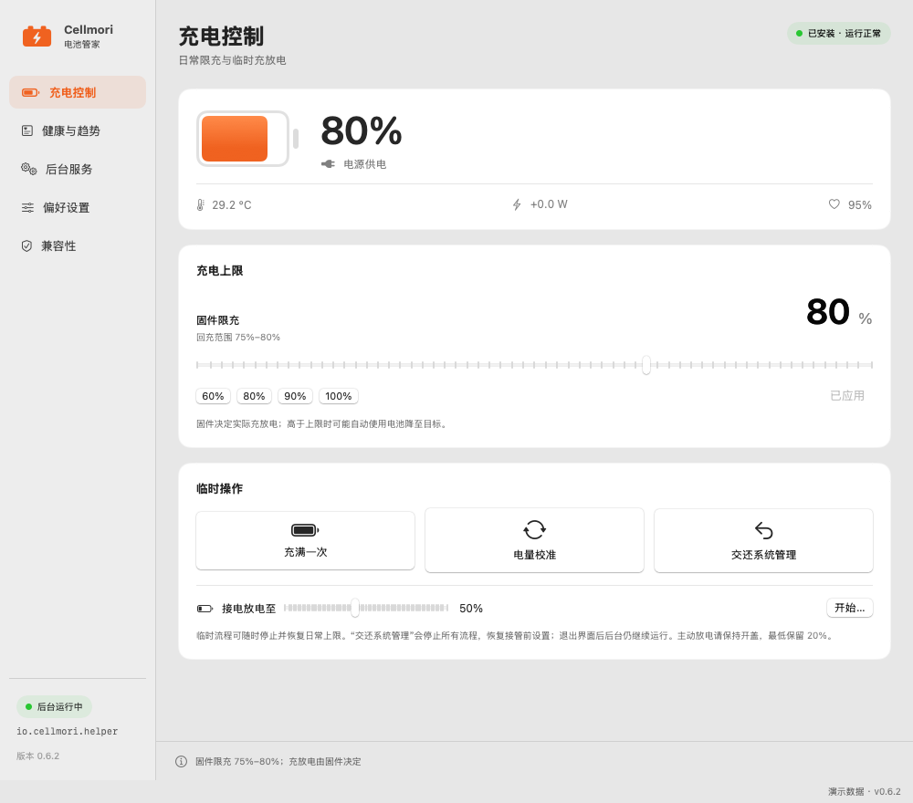
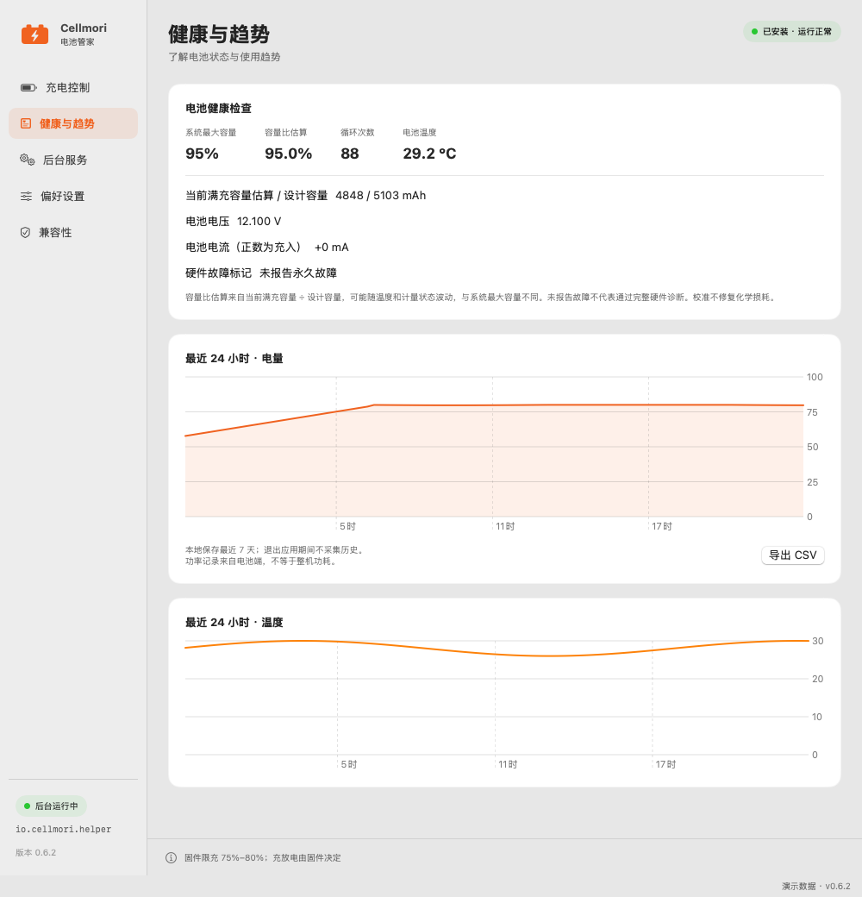
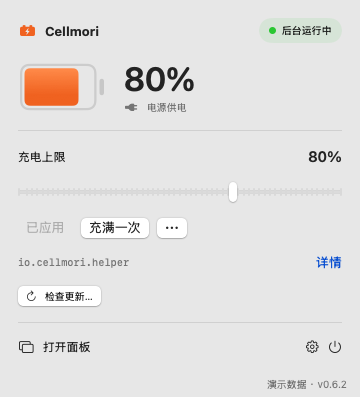
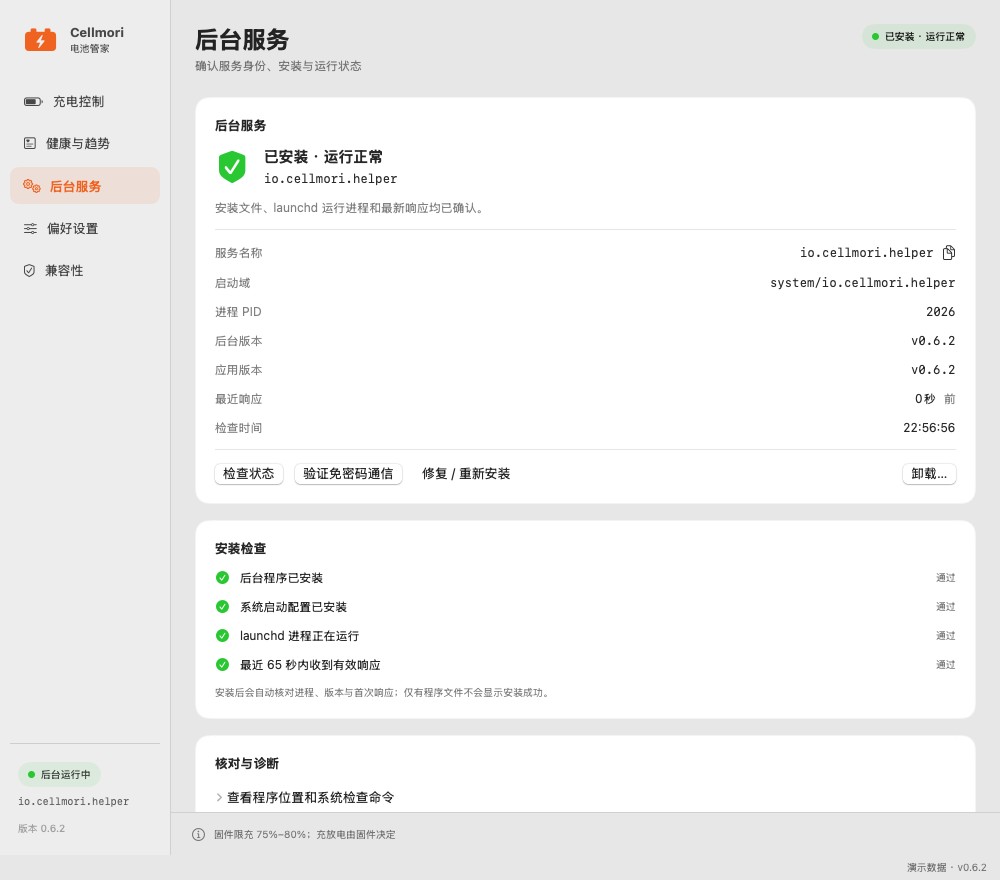
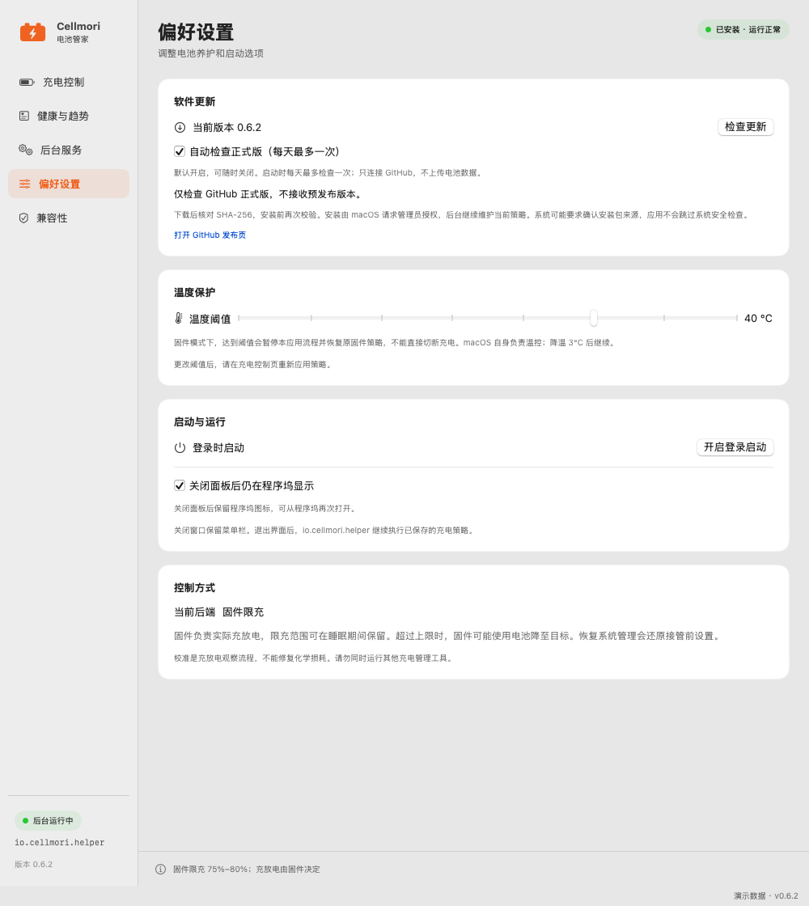

<div align="center">

# Cellmori 电池管家

**电量有上限，日常少操心。**

原生 macOS 菜单栏电池管理 · 限充 · 充满一次 · 接电放电 · 健康趋势


[](LICENSE)
[](https://github.com/AlanSune/Cellmori/releases/tag/v0.6.2)

[下载正式版 PKG](https://github.com/AlanSune/Cellmori/releases/latest) · [English](README.en.md) · [使用指南](docs/USAGE.md) · [反馈问题](https://github.com/AlanSune/Cellmori/issues)



</div>

## 让电池管理更直观

| 你想做的事 | Cellmori 帮你完成 |
| --- | --- |
| 长时间插电办公 | 设置 40%–100% 日常上限，以 5 个百分点回差维持充电策略 |
| 出门前准备满电 | “充满一次”，完成后恢复已保存的日常上限 |
| 插着电也想降低电量 | 主动放电至指定目标，支持随时停止并恢复日常上限 |
| 看懂电池状态 | 系统最大容量、循环次数、温度、电流及本地趋势 |
| 少开一个大窗口 | 菜单栏显示电量与供电来源，快捷面板完成常用操作 |
| 想及时升级 | 应用内检查正式版、查看说明、下载校验包并打开系统安装器 |
| 不想反复输入密码 | 安装后台时授权，日常控制通过校验身份的 XPC 执行 |

当前应用与后台均为 **0.6.2**，采用 [MIT 许可证](LICENSE)，没有第三方包依赖。原生 SwiftUI / AppKit 界面，本地处理电池数据，无账户、无内置遥测上传；仅检查或下载更新时连接 GitHub。

**macOS 26 已有 MacBook Pro（M4）用户实机验证。** 用户报告在 0.6.0 系列中“全部功能”均已验证可用；芯片为 M4；未提供系统小版本或逐项日志。这是该设备上的使用反馈，不表示所有 Mac 与固件均保证兼容。详见[兼容性与验证范围](docs/COMPATIBILITY.md)。

## 功能预览

以下图片由应用真实 SwiftUI 视图离屏渲染，标有“演示数据”，不包含个人电池记录，也不是 macOS 26 的实机截图。

### 健康信息与趋势

不用猜电池正在发生什么：查看电量与温度变化、循环次数和系统健康信息；最近 7 天趋势保存在本机，可导出 CSV。



### 菜单栏快捷操作与可核对的后台

打开主界面、偏好或后台详情时，快捷面板会先关闭，不再遮挡操作。后台页明确展示服务名称、版本、进程和响应状态。

<table>
<tr><td width="36%"></td><td></td></tr>
</table>

### 应用内检查更新

从“偏好设置 → 软件更新”、Cellmori 应用菜单或菜单栏快捷面板检查正式版本，查看说明后下载。安装包通过 SHA-256 校验后，可点击“安装更新并退出”打开系统安装器，安装验证通过后自动重新打开应用。自动检查默认开启，每天最多检查一次；可随时关闭，不会自动下载或安装。



## 安装与开始使用

1. 从 [Releases 下载最新 PKG](https://github.com/AlanSune/Cellmori/releases/latest)，退出正在运行的 Cellmori 后安装。
2. 应用安装至 `/Applications/Cellmori.app`。后台组件默认勾选；取消后仍可只读监测。
3. 打开“后台服务”，核对 `io.cellmori.helper` 与“已安装 · 运行正常”；可点击“验证免密码通信”。
4. 新安装默认由 macOS 管理。设定上限后点击“应用上限”；安装不会自行启动放电、校准或实验模式。

安装包面向 **Apple Silicon / macOS 15.x、26.x**。当前应用与后台使用 ad-hoc 本地签名及 Hardened Runtime，**PKG 未使用 Developer ID Installer 签名，也未公证**。GitHub 的“正式版”表示非预发布 Release，不代表 Apple 公证或全部机型认证。请勿关闭 SIP 或全局安全检查来运行。

安装、更新和卸载后台需要管理员授权；日常配置无需逐次输入密码。由于本地签名绑定精确代码哈希，更新或自行重建应用后应同步更新后台绑定。

## 几件值得分清的事

- **停止临时流程**：结束放电、充满一次或校准，恢复已保存的日常上限。
- **交还系统管理**：停止本程序控制，恢复接管前设置。
- **退出界面**：停止菜单栏与个人历史采样，后台继续维护策略。
- **外接供电 ≠ 正在充电**：解除上限后，macOS 仍可能延迟开始充电。
- **健康信息 ≠ 电池修复**：校准是充放电观察流程，不能修复化学损耗或重置计量芯片。

接口取决于固件和写权限；读得到不等于写得进。实验性适配器模式仅清醒且开盖时工作。完整使用与卸载步骤见[使用指南](docs/USAGE.md)。

## 从源码构建

```sh
bash test.sh                 # 102 项无硬件策略检查
bash test-updates.sh         # 版本选择、来源及下载校验检查
bash test-ui.sh              # 菜单栏面板导航的离屏回归检查
bash build.sh               # 构建并本地签名应用
bash build-installer.sh     # 生成 dist/ 下的 PKG
```

使用 Apple Silicon Mac 与 Xcode Command Line Tools；已知开发工具链为 Swift 6.1.2。构建和测试不会安装后台或更改充电策略。[构建指南](docs/BUILDING.md)包含环境、截图生成和签名说明。

## 项目文档

[使用](docs/USAGE.md) · [兼容性](docs/COMPATIBILITY.md) · [故障排查](docs/TROUBLESHOOTING.md) · [架构](docs/ARCHITECTURE.md) · [验证记录](docs/VALIDATION.md) · [更新记录](CHANGELOG.md)

[贡献](CONTRIBUTING.md) · [安全政策](SECURITY.md) · [隐私](PRIVACY.md) · [发布指南](docs/RELEASING.md) · [第三方说明](THIRD_PARTY_NOTICES.md)

欢迎在 [Issues](https://github.com/AlanSune/Cellmori/issues) 反馈机型、系统版本和使用体验。安全问题请通过仓库的私密漏洞报告渠道提交。

## 许可证

源码和原创文档采用 [MIT](LICENSE)，允许使用、修改、分发及商用，需保留版权与许可声明；第三方材料遵循各自条款。本项目与 Apple、AlDente 或其他电池工具没有隶属或背书关系。品牌检索不等于商标权利保证，见[名称说明](docs/NAMING.md)。
